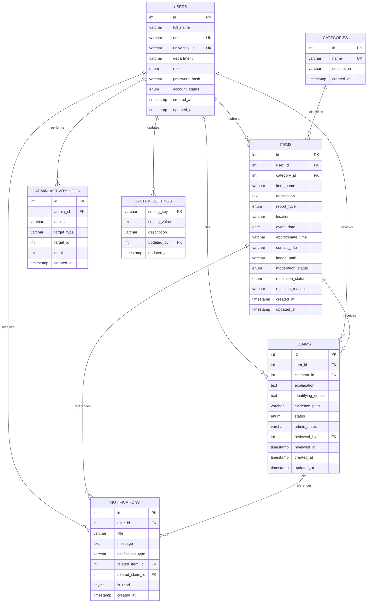

# Entity-Relationship Diagram & Database Documentation

## 1. Entity-Relationship Diagram (`where_is_it_db`)

## 2. Schema Highlights & Constraints

- **Engine:** `InnoDB` across all tables to support foreign keys and ACID transactions.
- **Character Set:** `utf8mb4` / `utf8mb4_unicode_ci` (and `utf8mb4_bin` for `sessions`).
- **Uniqueness Constraints:** `users.email`, `users.university_id`, and `categories.name`.
- **Referential Integrity:**
  - Deleting a user cascades to their items, claims, and notifications.
  - Deleting a category with existing items is blocked (`ON DELETE RESTRICT`) to prevent orphaned reports.
  - Deleting an item cascades to claims (`ON DELETE CASCADE`) and sets `related_item_id` to `NULL` on notifications (`ON DELETE SET NULL`).
- **Indexes:** Composite index `idx_items_type_mod` accelerates public Lost/Found browsing; `idx_notifications_user_read` accelerates unread badge counts.

