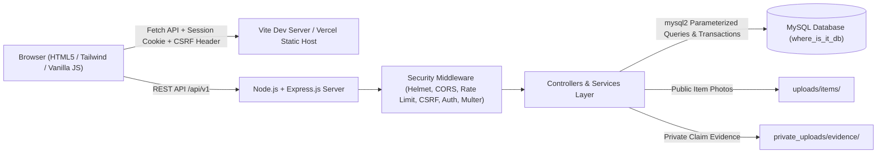
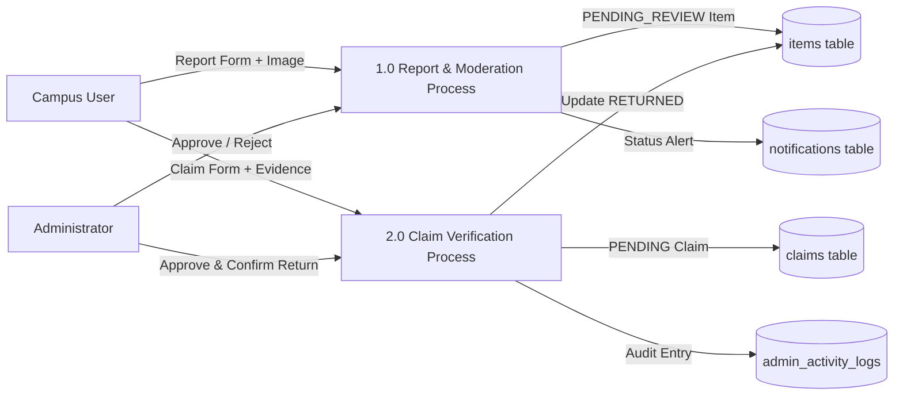
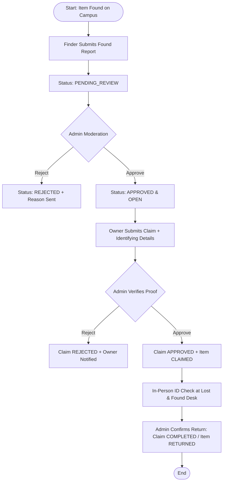
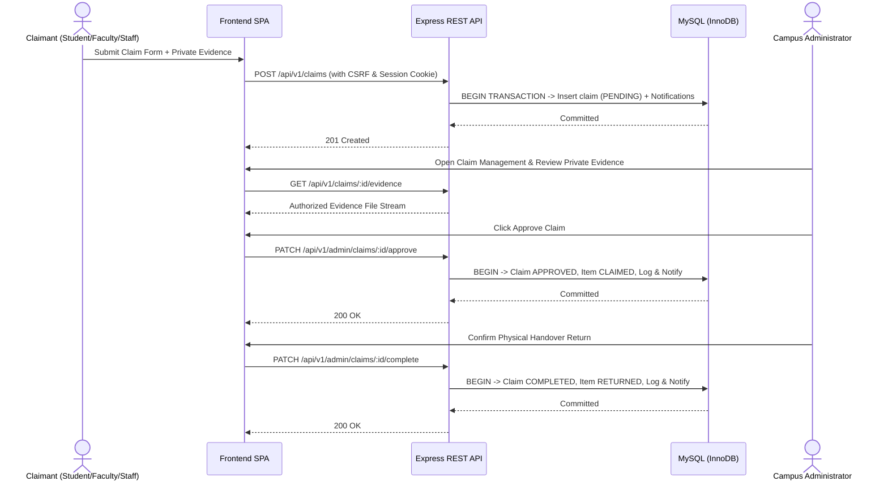

# Software Requirements Specification (SRS) — Where Is It?

## 1. Introduction

This document specifies the functional requirements, non-functional requirements, system architecture, and behavioral diagrams for **Where Is It? — Campus Lost & Found Management System**.

## 2. Functional Requirements

### FR-1: Authentication & Account Management
- **FR-1.1:** Users can register as `STUDENT`, `FACULTY`, or `STAFF` with full name, unique university email, unique university ID, department, and password. Public registration as `ADMIN` is prohibited.
- **FR-1.2:** Passwords are hashed using `bcrypt` before database storage.
- **FR-1.3:** Users authenticate via session-based cookies persisted in MySQL (`sessions` table).
- **FR-1.4:** Authenticated users can update their profile and change their password.
- **FR-1.5:** Suspended users (`SUSPENDED`) are blocked from logging in and active sessions are invalidated.

### FR-2: Lost & Found Item Reporting
- **FR-2.1:** Authenticated users can submit Lost or Found item reports with category, description, location, date, approximate time, contact note, and optional image upload (`JPG`, `JPEG`, `PNG`, `WebP` up to 5 MB).
- **FR-2.2:** Newly submitted reports default to `PENDING_REVIEW` moderation status and `OPEN` resolution status.
- **FR-2.3:** Owners can edit or delete their own reports when not `CLAIMED`, `RETURNED`, or `CLOSED`. Editing a reviewed report resets moderation to `PENDING_REVIEW`.

### FR-3: Search, Filtering & Item Details
- **FR-3.1:** Public Lost Items and Found Items pages display only `APPROVED` reports.
- **FR-3.2:** Users can search by keyword and filter by category, location, date, resolution status, and sort order (`newest`/`oldest`) with pagination.
- **FR-3.3:** Item detail views protect private user information (emails and university IDs are never exposed publicly).

### FR-4: Ownership Claims & Return Coordination
- **FR-4.1:** Authenticated users can submit ownership claims on eligible `APPROVED` `FOUND` items (`OPEN`/`MATCHED`) with explanation, identifying details, and optional private evidence image.
- **FR-4.2:** Users cannot claim their own found report or submit duplicate active claims for the same item.
- **FR-4.3:** Private claim details and evidence files are stored outside public web directories and accessible only to the claimant and administrators.
- **FR-4.4:** Claimants can withdraw `PENDING` claims.
- **FR-4.5:** Administrators can approve or reject claims and confirm physical handover (`COMPLETED` claim / `RETURNED` item) inside atomic MySQL transactions.

### FR-5: Notifications
- **FR-5.1:** System generates notifications for report submission, approval, rejection, claim submission, claim approval/rejection, item return, and admin broadcasts.
- **FR-5.2:** Users can view unread counts, mark individual notifications read, and mark all notifications read.

### FR-6: Administration & Governance
- **FR-6.1:** Administrators access real-time dashboard statistics, user management (suspend/reactivate), report moderation, claim verification, category CRUD, activity logs, and system settings.
- **FR-6.2:** Every administrative action is recorded in `admin_activity_logs`.

## 3. Non-Functional Requirements

- **NFR-1 Security:** Parameterized SQL queries prevent SQL injection; `helmet`, `csrf-csrf`, `express-rate-limit`, `express-validator`, HTTP-only cookies, and HTML escaping prevent CSRF, XSS, brute-force attacks, and broken access control.
- **NFR-2 Usability & Responsiveness:** Responsive across desktop, laptop, tablet, and mobile viewports with loading, empty, error, and confirmation states.
- **NFR-3 Reliability & Data Integrity:** InnoDB foreign keys, unique constraints, and multi-step MySQL transactions prevent partial state updates.
- **NFR-4 Maintainability:** Modular separation across routes, controllers, services, validators, middleware, and frontend ES6 modules.

## 4. System Architecture Diagram

## 5. Use Case Diagram

```mermaid
flowchart TB
    Guest(["Campus Visitor / Guest"])
    Member(["Student / Faculty / Staff"])
    Admin(["Campus Administrator"])

    UC1["Browse & Search Approved Items"]
    UC2["Register & Log In"]
    UC3["Report Lost / Found Item"]
    UC4["Manage Own Reports"]
    UC5["Submit Ownership Claim + Private Evidence"]
    UC6["Track Notifications & Profile"]
    UC7["Moderate Reports (Approve / Reject)"]
    UC8["Verify Claims & Confirm Return"]
    UC9["Manage Users, Categories, Logs & Settings"]

    Guest --> UC1
    Guest --> UC2
    Member --> UC1
    Member --> UC3
    Member --> UC4
    Member --> UC5
    Member --> UC6
    Admin --> UC7
    Admin --> UC8
    Admin --> UC9
```

## 6. Data Flow Diagram (Level 0 & Level 1)

## 7. Activity Diagram (Lost/Found Recovery Lifecycle)

## 8. Sequence Diagram (Ownership Claim & Return Flow)

